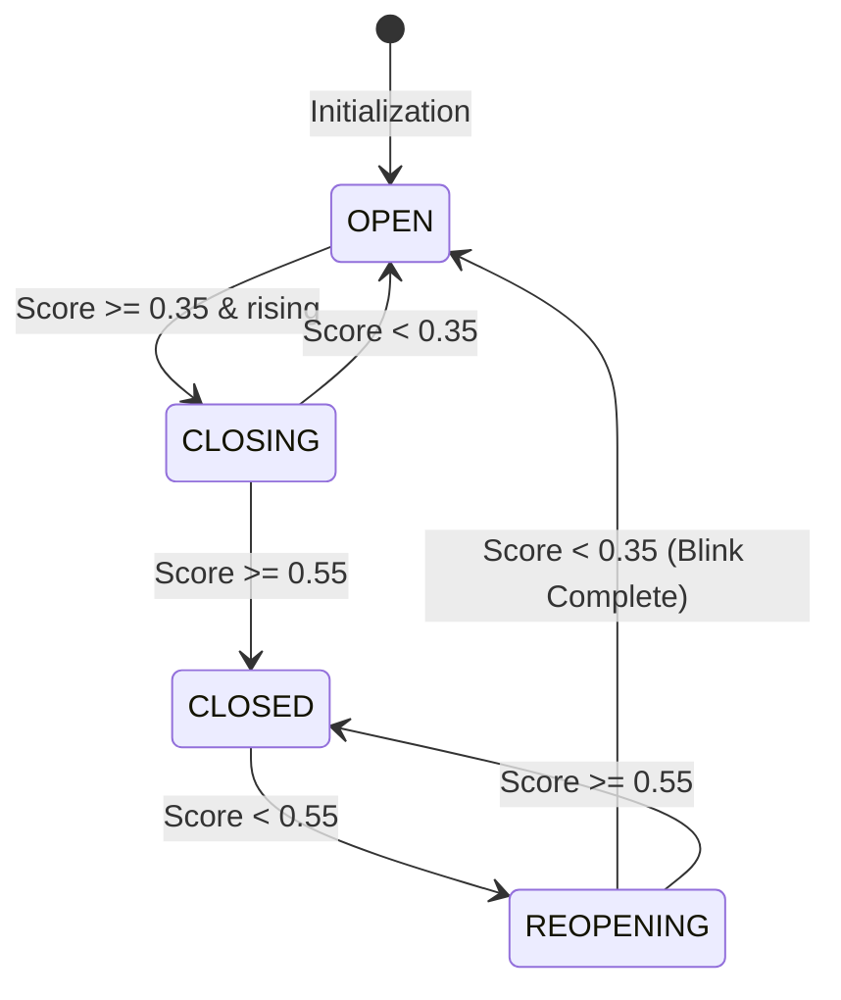

# EyeMouse Blink Detection Specification

## 1. Overview and Approach

EyeMouse implements an independent, modular blink detector in `src/vision_engine/blink.py`. Rather than relying on simple geometric Eye Aspect Ratio (EAR) heuristics (which suffer from sensitivity to head pose, squinting, and camera distance), the detector leverages MediaPipe's trained facial blendshape scores (`eyeBlinkLeft`, `eyeBlinkRight`) combined with temporal smoothing and a dual-threshold hysteresis state machine.

---

## 2. Blendshape Signal Processing

MediaPipe FaceLandmarker provides 52 facial blendshape classification scores representing coefficients $[0.0 \dots 1.0]$. The blink detector consumes:
- `eyeBlinkLeft`: Degree of left eyelid closure.
- `eyeBlinkRight`: Degree of right eyelid closure.

### 2.1 Exponential Smoothing
To mitigate high-frequency sensor noise without introducing perceptible latency:
$$S_t = (1 - \alpha) \cdot S_{t-1} + \alpha \cdot M_t$$
where $M_t$ is the raw MediaPipe blendshape score and $\alpha = 0.70$ provides rapid response (~1.5 frames).

---

## 3. Dual-Threshold Hysteresis State Machine

A single threshold causes rapid "chattering" (rapid flickering between open and closed states) when an eyelid hovers near the boundary. To guarantee clean transitions, EyeMouse implements dual hysteresis thresholds:

- **`CLOSED_THRESHOLD = 0.55`**: Blendshape score must cross this value to transition into `CLOSING` / `CLOSED`.
- **`OPEN_THRESHOLD = 0.35`**: Blendshape score must fall below this value to transition back to `OPEN`.



### 3.1 Blink Phases (`BlinkPhase` Enum)
1. **`OPEN`**: Both eyes are open; normal gaze tracking active.
2. **`CLOSING`**: Eyelids are descending; closure has begun.
3. **`CLOSED`**: Both eyelids are fully depressed past the closure threshold.
4. **`REOPENING`**: Eyelids are ascending after a closure.

---

## 4. Temporal Classification: Involuntary Reflex vs Intentional Sustained Blink

Human blinks exhibit well-documented temporal characteristics:
- **Involuntary Spontaneous Blink**: Typically lasts between **100 ms and 250 ms**. Occurs reflexively for corneal lubrication.
- **Intentional Sustained Blink**: Sustained closure lasting **350 ms or longer** ($\ge 0.35\text{s}$), indicating a deliberate user action.
- **Micro-Artifacts**: Closures under **50 ms** are rejected as frame drop artifacts or momentary tracking dropouts.

The `BlinkDetector` tracks the wall-clock closure duration:
```python
closure_duration_ms = (timestamp_s - closure_start_time) * 1000.0
is_intentional_sustained = closure_duration_ms >= 350.0
```

---

## 5. Architectural Boundaries and Safety Requirements

> [!IMPORTANT]
> **No Synthetic Mouse Clicks in M2**:
> The blink detector emits structured `BlinkEvent` records across IPC. It does **NOT** generate mouse clicks, synthetic events, or OS actions.
>
> 1. **Milestone Boundary**: Mouse event synthesis belongs to M3 (Native macOS Menu Bar Host) and M4 (End-to-End Control).
> 2. **Physical Shortcut Gating**: Even when blink clicks are mapped in future milestones, clicks must be strictly gated by the physically held activation shortcut. No click may ever fire while eye control is inactive.
> 3. **Testing Caveat**: Blendshape-based intentional blink detection requires extensive empirical calibration across diverse eye shapes and lighting conditions. Final production accuracy must not be assumed prior to human subject testing.

