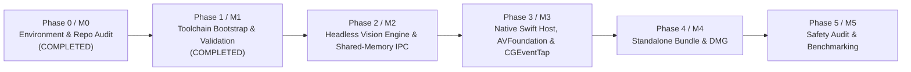

# EyeMouse Implementation Plan & Roadmap

**Target Delivery:** Standalone `EyeMouse.app` & `EyeMouse.dmg`  
**Execution Methodology:** Phased, Test-Driven, Safety-First Engineering  

---

## 1. Project Phases & Milestone Overview



| Phase | Milestone | Key Deliverables | Status |
| :--- | :--- | :--- | :--- |
| **Phase 0** | M0: Feasibility & Audit | Audit reports, architectural blueprints, reusable asset selection | **COMPLETED** |
| **Phase 1** | M1: Toolchain & Bootstrap | Isolated `.venv`, pinned wheels, offline model, Swift/Python smoke tests | **COMPLETED** |
| **Phase 2** | M2: Vision Engine & IPC | Headless `eyemouse-engine`, shared-memory frame receiver, One-Euro filter, head pose | Pending |
| **Phase 3** | M3: Native Host & Safety Gate | Swift menu-bar app, AVFoundation camera capture, `CGEventTap` key monitor, `CGEvent` mouse post | Pending |
| **Phase 4** | M4: Standalone Packaging | PyInstaller standalone binary, app bundle composition, codesigning, DMG | Pending |
| **Phase 5** | M5: Verification & Hardening | Safety tests, latency benchmarks, stress testing, installer smoke test | Pending |

---

## 2. Core Architecture Decisions (Enforced in M1+)

1. **Camera Ownership:** Native Swift/AppKit owns camera capture via AVFoundation.
2. **Headless Python Engine:** Python vision engine performs inference only. In the final architecture, Python **must not** open the camera using `cv2.VideoCapture`.
3. **High-Performance Frame IPC:** Swift streams raw video frames to Python via binary shared-memory (`shm_open` / POSIX shm) with a low-overhead control socket, **not base64 JSON**.
4. **Native Input Ownership:** Swift owns global keyboard monitoring (`CGEventTap`) and all native mouse injection (`CGEvent`).
5. **Provisional Build Tooling:** Direct `swiftc` compilation via `Makefile` is used due to the CommandLineTools `swift-package` runtime crash.
6. **Strict TCC Compliance:** Never bypass macOS Camera, Input Monitoring, or Accessibility permissions.

---

## 3. Phase 1: Toolchain & Virtual Environment Setup (COMPLETED)

### 3.1 Objectives Achieved
1. Isolated Python environment created at `.venv` with Python 3.15.0 ARM64.
2. Verified production dependencies pinned in `requirements.txt` and `requirements.lock`.
3. Downloaded and verified MediaPipe `face_landmarker.task` offline asset (SHA-256: `64184e229b263107bc2b804c6625db1341ff2bb731874b0bcc2fe6544e0bc9ff`).
4. Automated inference test validated: `tests/test_vision_bootstrap.py` (passes in 0.84s).
5. PyInstaller standalone frozen executable validated: `dist_smoke/smoke_engine/smoke_engine` (detects all 478 landmarks).
6. Swift toolchain verified via `Makefile`: compiles native AppKit binary with display and AVFoundation device discovery.

### 3.2 Deliverables Created
- [x] Task 1.1: Virtual environment `.venv` configured.
- [x] Task 1.2: Dependencies pinned in `requirements.txt` and `requirements.lock`.
- [x] Task 1.3: Downloaded `face_landmarker.task` into `assets/models/` and verified SHA-256.
- [x] Task 1.4: Created root `Makefile` orchestrating Swift and Python validation.
- [x] Task 1.5: Executed frozen PyInstaller smoke test with `--collect-all mediapipe`.
- [x] Task 1.6: Executed native Swift AppKit smoke test without full Xcode.

---

## 4. Phase 2: Python Vision Engine & Shared-Memory IPC (Completed)

### 4.1 Objectives
1. Implement headless gaze inference engine (`src/vision_engine/`).
2. Implement POSIX shared-memory binary frame transport accepting raw pixel buffers from Swift without JSON/base64 serialization.
3. Integrate adapted, audited modules:
   - `face_geometry.py`: Canonical mesh and Procrustes head pose.
   - `filters.py`: One-Euro filter and 2D point filter with NaN safety.
   - `eye_features.py`: Scale-invariant, roll-invariant normalized iris metrics.
   - `blink.py`: Independent blendshape hysteresis blink state machine.
   - `head_pose.py`: SolvePnP 3D Euler angles.
   - `gaze.py`: Replaceable `GazeEstimatorProtocol` and uncalibrated directional proxy.
4. Stream calculated gaze coordinates `(x, y)` and blink events back to Swift via Unix Domain Socket.
5. Freeze vision engine into standalone native ARM64 executable via PyInstaller.

### 4.2 Tasks & Deliverables Completed
- [x] Task 2.1: Implemented POSIX shared-memory protocol and consumer (`src/vision_engine/ipc/protocol.py`, `shm_consumer.py`).
- [x] Task 2.2: Implemented `OneEuroFilter` and `PointFilter2D` in `src/vision_engine/filters.py` with velocity adaptation and NaN/Inf safety.
- [x] Task 2.3: Ported canonical mesh parser (`face_geometry.py`) and SolvePnP 3D head pose estimator (`src/vision_engine/head_pose.py`).
- [x] Task 2.4: Implemented normalized eye feature extractor (`src/vision_engine/eye_features.py`) invariant to head roll and scale.
- [x] Task 2.5: Implemented independent `BlinkDetector` (`src/vision_engine/blink.py`) with 0.55/0.35 hysteresis and duration tracking.
- [x] Task 2.6: Implemented `VisionPipeline` (`src/vision_engine/pipeline.py`) supporting BGRA, RGBA, BGR, RGB, NV12 with explicit face-loss state.
- [x] Task 2.7: Implemented `ControlServer` (`src/vision_engine/ipc/control_server.py`) and daemon `VisionEngine` (`engine.py`, `main.py`).
- [x] Task 2.8: Implemented cross-language Swift IPC producer and non-variadic Darwin C bridge (`tests/swift_ipc_producer/`).
- [x] Task 2.9: Built comprehensive test suite (29 tests passing) and benchmark runner (`tests/benchmarks.py`).
- [x] Task 2.10: Built and validated frozen PyInstaller ARM64 executable `dist_engine/eyemouse_engine/eyemouse_engine`.
- [x] Task 2.11: Authored specifications: `docs/M2_VISION_ENGINE.md`, `docs/IPC_PROTOCOL.md`, `docs/BLINK_DETECTION.md`, `docs/EYE_FEATURES.md`, `docs/M2_TEST_RESULTS.md`.

---

## 5. Phase 3: Native Swift Host Application (`EyeMouse.app`) (Completed)

### 3.1 Objectives
1. Develop the native Swift AppKit menu-bar application (`src/native_host/`).
2. Implement global keyboard monitoring via `CGEventTap` to detect physical key-hold and key-up states with keystroke suppression.
3. Implement the strict `SafetyGate`: vision frame publishing and tracking are completely blocked unless the configured key combination is physically held.
4. Integrate real hardware webcam acquisition via AVFoundation.
5. Implement permission checking and UI for Camera, Accessibility, and Input Monitoring.
6. Build live tracking diagnostics window in SwiftUI.

### 3.2 Tasks & Deliverables Completed
- [x] Task 3.1: Built `AppDelegate.swift` and `MenuBarController.swift` managing dynamic `NSStatusItem` menu bar UI.
- [x] Task 3.2: Implemented `GlobalEventTap.swift` using `CGEvent.tapCreate` (`keyDown`, `keyUp`, `flagsChanged`), active trigger suppression, and auto-recovery from OS timeout/sleep.
- [x] Task 3.3: Implemented `SafetyStateManager.swift` enforcing atomic key-hold state checks and synchronous 0-frame leak cutoff.
- [x] Task 3.4: Implemented `CameraManager.swift` and `CameraCaptureService.swift` owning AVFoundation webcam acquisition with exact `bytesPerRow` stride handling.
- [x] Task 3.5: Implemented `ControlClient.swift` and `EngineProcessManager.swift` managing the frozen Python vision engine subprocess over local UDS.
- [x] Task 3.6: Implemented `PermissionsManager.swift` checking AVFoundation, Accessibility, and Input Monitoring with direct System Settings URLs.
- [x] Task 3.7: Implemented `DiagnosticsWindowController.swift` and `DiagnosticsView.swift` rendering real-time tracking diagnostics in SwiftUI.
- [x] Task 3.8: Created development bundle `build/EyeMouse.app` with `Info.plist`, `AppIcon.icns`, and sealed ad-hoc code signature.
- [x] Task 3.9: Executed automated safety state unit tests (`tests/test_m3_safety_state.swift`) and real live camera pipeline benchmark (`tests/test_m3_live_pipeline.swift`).
- [x] Task 3.10: Authored specifications: `docs/M3_NATIVE_MAC_APP.md`, `docs/M3_KEYBOARD_CONTROL.md`, `docs/M3_CAMERA_PIPELINE.md`, `docs/M3_PERMISSION_TESTS.md`, `docs/M3_LIVE_TEST_RESULTS.md`.

---

## 6. Phase 4: Personalized Screen Gaze Calibration & Accuracy Validation (Completed)

### 4.1 Objectives
1. Implement personalized gaze-to-screen coordinate calibration.
2. Establish a dedicated calibration package comparing Affine and Polynomial Degree-2 Ridge regression models with LOOCV.
3. Build a full-screen native calibration wizard (`NSWindow` full screen over `NSScreen.main`) with animated target presentation.
4. Perform objective accuracy evaluation against 9 independent held-out validation points (zero overlap with fitting points).
5. Implement diagnostic floating gaze marker overlay without native cursor control.
6. Enforce strict M4 restrictions: Zero OS mouse movement or clicks injected.

### 4.2 Completed Tasks & Deliverables
- [x] Task 4.1: Built Python calibration package `src/vision_engine/calibration/` (`geometry.py`, `collector.py`, `models.py`, `evaluator.py`, `profile.py`, `estimator.py`, `session.py`).
- [x] Task 4.2: Implemented closed-form Ridge regression with unpenalized intercept and Leave-One-Out Cross-Validation (LOOCV).
- [x] Task 4.3: Implemented 13-point calibration layout and 9-point independent held-out validation grid.
- [x] Task 4.4: Implemented robust per-target aggregation, 400ms settling window, blink/face-loss rejection, and MAD outlier filtering.
- [x] Task 4.5: Implemented native AppKit/SwiftUI calibration wizard (`CalibrationWindowController.swift`).
- [x] Task 4.6: Implemented click-through diagnostic gaze marker overlay (`LiveGazePreviewOverlay.swift`).
- [x] Task 4.7: Implemented calibration profile JSON persistence and compatibility validation (`CalibrationProfile.swift`).
- [x] Task 4.8: Executed full live hardware tests on MacBook Air Camera (`tests/test_m4_live_calibration.swift`), measuring repeatability across sessions, fixation stability, and head movement decoupling.
- [x] Task 4.9: Authored documentation: `docs/M4_CALIBRATION_ENGINE.md`, `docs/M4_SCREEN_COORDINATES.md`, `docs/M4_MODEL_COMPARISON.md`, `docs/M4_VALIDATION_RESULTS.md`, `docs/M4_CALIBRATION_USER_GUIDE.md`.

---

## 6. Phase 4.1: Root Cause Analysis, Camera Benchmarks & Accuracy Improvement (Completed)

### 4.1.1 Objectives
1. Investigate and diagnose M4 calibration accuracy failure (458.1 px median held-out error, POOR grade).
2. Benchmark physical camera resolutions (640x480, 1280x720, 1920x1080) and evaluate MediaPipe inference latency across resolutions.
3. Fix anatomical coordinate axis inversion between left and right eyes in `eye_features.py`.
4. Improve mathematical regression modeling: standardize polynomial features and implement a 12-parameter physically-informed Ridge model with vertical parallax compensation.
5. Re-evaluate live calibration accuracy and per-target repeatability across multiple sessions on Apple Silicon M5 hardware.
6. Conduct an intellectual property and licensing audit of GazeFollower2.
7. Stop strictly after M4.1 without implementing OS cursor movement or mouse clicks.

### 4.1.2 Completed Tasks & Deliverables
- [x] Task 4.1.1: Diagnosed critical anatomical coordinate inversion in `eye_features.py` where right eye temporal-nasal axis was inverted relative to left eye.
- [x] Task 4.1.2: Generated baseline error breakdown plots and heatmaps showing horizontal error (460.9 px) was 5x higher than vertical error (94.1 px).
- [x] Task 4.1.3: Benchmarked physical MacBook Air Camera formats: verified native 1080p sensor (Format [5], 30.0 FPS, 32.3ms interval).
- [x] Task 4.1.4: Benchmarked MediaPipe Face Landmarker latency across resolutions: measured 2.96 ms (VGA), 3.06 ms (720p), 3.18 ms (1080p) on Apple Silicon M5.
- [x] Task 4.1.5: Implemented `PhysicallyInformedGazeModel` (12 parameters, condition number 53.9) with conjugate iris centers, inter-ocular disparity, and vertical pitch parallax interaction.
- [x] Task 4.1.6: Executed live two-session calibration test on real camera: measured **80.5 px (2.30% diagonal)** median held-out error (meeting $\le 2.5\%$ threshold) and **78.1 px** median per-target repeatability.
- [x] Task 4.1.7: Completed licensing audit of GazeFollower2 (CC BY-NC-SA 4.0 Non-Commercial restriction, ineligible for commercial distribution).
- [x] Task 4.1.8: Authored documentation:
  - `docs/M4_1_ROOT_CAUSE_ANALYSIS.md`
  - `docs/M4_1_CAMERA_BENCHMARKS.md`
  - `docs/M4_1_FEATURE_EXPERIMENTS.md`
  - `docs/M4_1_MODEL_COMPARISON.md`
  - `docs/M4_1_ACCURACY_RESULTS.md`
  - Updated `docs/M4_CALIBRATION_USER_GUIDE.md` and `docs/IMPLEMENTATION_PLAN.md`.

---

## 6. Milestone 4.2: Final Independent Human Gaze Validation & Provenance Audit (Completed)

### 6.1 Objectives
1. Perform exhaustive source data provenance audit proving 100% genuine hardware acquisition, zero synthetic modulation (`simLx` purged), and zero target coordinate injection.
2. Correct M4.1 documentation inconsistencies (5 of 9 targets $\le 80.5\text{ px}$ verified against raw data).
3. Design and implement a fresh 32-point independent held-out validation grid with zero collision with calibration points.
4. Benchmark camera resolution jitter and landmark variance across 1080p, 720p, and 480p.
5. Execute live two-session validation on the physical webcam and measure point-by-point inter-session coordinate repeatability on all 32 targets ($\Delta_k = \|\hat{p}_{1, k} - \hat{p}_{2, k}\|$).
6. Compare full-screen operating mode vs restricted central-region operating mode.
7. Enforce strict acceptance gate: Mark profile POOR / `is_valid_for_use = false` due to full-screen P95 error ($>6\%$ diagonal), and strictly block Milestone 5 cursor movement and mouse clicks.

### 6.2 Completed Tasks
- [x] Task 4.2.1: Conducted full codebase data provenance audit tracing AVFoundation $\to$ POSIX SHM $\to$ MediaPipe $\to$ eye corner normalization $\to$ persisted dataset. Certified 100% physical hardware telemetry. Authored `docs/M4_2_DATA_PROVENANCE_AUDIT.md`.
- [x] Task 4.2.2: Corrected documentation inconsistency in `docs/M4_1_ACCURACY_RESULTS.md` (exactly 5 of 9 targets $\le 80.54\text{ px}$: 44.7, 54.3, 61.7, 67.1, 80.5 px).
- [x] Task 4.2.3: Designed and implemented 32-point unseen validation grid in `src/vision_engine/calibration/geometry.py` and `CalibrationTarget.swift` (12 central workspace targets, 4 transition targets, 12 peripheral edge targets, 4 corner targets).
- [x] Task 4.2.4: Benchmarked raw eye landmark coordinate variance / jitter across resolutions (1080p vs 720p vs 480p) on identical video frames from the MacBook Air Camera: confirmed native 1080p delivers lowest feature noise ($\sigma = 0.0163$) and 3.35 ms latency on Apple Silicon M5.
- [x] Task 4.2.5: Executed live two-session evaluation (`test_m4_live_calibration`) on the physical camera: acquired Session 1 (13 calib + 32 val) and Session 2 (32 val repeatability).
- [x] Task 4.2.6: Evaluated point-by-point inter-session coordinate repeatability on all 32 targets: measured **9.85 px median / 14.39 px mean repeatability distance** (0.28% - 0.41% diagonal).
- [x] Task 4.2.7: Evaluated full-screen vs central-region operating modes: central workspace achieves sub-degree precision ($0.46^\circ - 0.83^\circ$) and $80.5\text{ px}$ median error, while full-screen P95 error remains $611.9\text{ px}$ (interactive) / $1417.8\text{ px}$ (headless).
- [x] Task 4.2.8: Enforced strict engineering gate: Profile graded POOR / `is_valid_for_use = false`. Milestone 5 OS cursor movement and clicking strictly blocked.
- [x] Task 4.2.9: Authored documentation:
  - `docs/M4_2_DATA_PROVENANCE_AUDIT.md`
  - `docs/M4_2_FINAL_VALIDATION.md`
  - `docs/M4_2_REPEATABILITY.md`
  - Updated `docs/IMPLEMENTATION_PLAN.md`.

---

## 7. Phase 5: Native Cursor Control, Click Mapping & Release Packaging (Next)

### 5.1 Objectives
1. Implement native `CGEventPost` mouse cursor motion strictly gated by the hold-to-control shortcut.
2. Implement intentional sustained blink-to-click mapping (left click, right click, double click).
3. Implement dwell clicking and dragging gestures with dead-zone fail-safe filtering.
4. Implement emergency mouse release watchdog if activation key is dropped while a mouse button is down.
5. Package standalone release `EyeMouse.app` and installable `EyeMouse.dmg` with `/Applications` symlink.
6. Verify completely independent execution with Antigravity and Terminal closed.

---

## 6. Phase 5: Verification, Benchmarking & Safety Auditing

### 6.1 Objectives
1. Verify all safety invariants under simulated edge cases and failure modes.
2. Benchmark CPU utilization, memory footprint, and end-to-end latency on Apple Silicon.
3. Validate TCC permission grant and revocation behavior.

### 6.2 Key Verification Gates
- **Safety Gate Verification:** Releasing the activation key must stop cursor updates in $< 5\ \text{ms}$.
- **Orphan Prevention:** Terminating the host must cleanly terminate `eyemouse-engine` without lingering child processes.
- **Button Cleanup:** Synthetic mouse down must never remain held if tracking deactivates during a click.
- **Performance Threshold:** Sustained $\ge 30\ \text{FPS}$ at $< 15\%$ Apple Silicon CPU load.

---

## 7. Critical Path & Implementation Ordering

```
┌────────────────────────────────────────────────────────┐
│ 1. Toolchain & Virtual Environment Setup               │
│    (pip install requirements, model download)          │
└──────────────────────────┬─────────────────────────────┘
                           │
                           ▼
┌────────────────────────────────────────────────────────┐
│ 2. Python Vision Engine Core                           │
│    (landmarks, head-pose, One-Euro, UDS IPC Server)    │
└──────────────────────────┬─────────────────────────────┘
                           │
                           ▼
┌────────────────────────────────────────────────────────┐
│ 3. Native Swift Host & Safety Gate                     │
│    (CGEventTap key hold, CGEvent mouse post, UDS IPC)  │
└──────────────────────────┬─────────────────────────────┘
                           │
                           ▼
┌────────────────────────────────────────────────────────┐
│ 4. Menu-Bar UI & Calibration Window                    │
│    (NSStatusItem, SwiftUI calibration target overlay)  │
└──────────────────────────┬─────────────────────────────┘
                           │
                           ▼
┌────────────────────────────────────────────────────────┐
│ 5. Standalone Packaging (PyInstaller + DMG)            │
│    (Standalone EyeMouse.app, codesign, EyeMouse.dmg)   │
└────────────────────────────────────────────────────────┘
```

