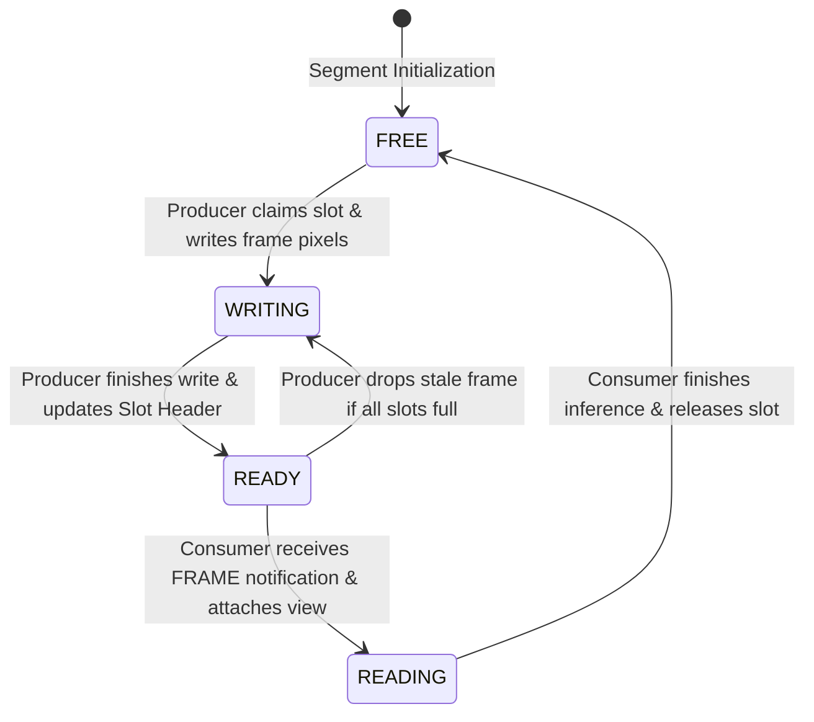

# EyeMouse Inter-Process Communication (IPC) Protocol

## 1. Overview and Architecture

EyeMouse implements a decoupled two-tier IPC architecture between the native Swift/AppKit host and the headless Python vision engine:

1. **Data Plane (High Throughput, Zero-Copy)**: POSIX Shared Memory (`shm_open`, `ftruncate`, `mmap`) ring buffer for raw video frames. Video frames are never copied, serialized to JSON, or base64 encoded.
2. **Control Plane (Low Latency, Synchronization)**: Unix Domain Socket (AF_UNIX stream) transporting newline-delimited JSON commands, notifications, and telemetry metadata.

```
+-------------------------------------------------------------------------+
|                           SWIFT HOST (Producer)                         |
|  - AVFoundation Video Capture (BGRA / 60 FPS)                          |
|  - Writes raw pixel buffer directly into mapped SHM Slot               |
+-------------------+---------------------------------+-------------------+
                    | (1) Data Plane                  | (2) Control Plane
                    |     POSIX Shared Memory         |     Unix Domain Socket
                    v                                 v
+-------------------+---------------------------------+-------------------+
|                     PYTHON VISION ENGINE (Consumer)                     |
|  - Reads raw buffer view via NumPy (zero allocation)                    |
|  - Executes MediaPipe Landmarker, Pose, Eye & Blink tracking            |
|  - Returns lightweight JSON ACK containing gaze & blink coordinates     |
+-------------------------------------------------------------------------+
```

---

## 2. Shared Memory Binary Layout

All multi-byte numeric fields are encoded in **Little-Endian (`<`)**.

The shared memory segment consists of a 64-byte Global Header followed by $N$ contiguous Slot Segments. Each Slot Segment begins with a 64-byte Slot Header, followed by a raw pixel payload buffer.

```
+---------------------------------------------------------------+
| Global Header (64 bytes)                                      |
+---------------------------------------------------------------+
| Slot 0 Header (64 bytes)  | Slot 0 Pixel Payload (4 MiB)      |
+---------------------------------------------------------------+
| Slot 1 Header (64 bytes)  | Slot 1 Pixel Payload (4 MiB)      |
+---------------------------------------------------------------+
| ...                                                           |
+---------------------------------------------------------------+
| Slot N-1 Header (64 bytes)| Slot N-1 Pixel Payload (4 MiB)    |
+---------------------------------------------------------------+
```

### 2.1 Global Header (64 Bytes)

`GLOBAL_HEADER_FORMAT = "<4sIIIiiII32s"`

| Byte Offset | Type | Field Name | Description |
|---|---|---|---|
| 0–3 | `char[4]` | `magic` | Magic ASCII marker: `"EMSH"` (`0x45 0x4D 0x53 0x48`) |
| 4–7 | `uint32` | `version` | Protocol version (currently `1`) |
| 8–11 | `uint32` | `num_slots` | Total slot count in the ring buffer (default `4`) |
| 12–15 | `uint32` | `slot_size_bytes` | Allocated byte size per slot including slot header (default `4,194,304` = 4 MiB) |
| 16–19 | `int32` | `producer_pid` | Process ID of the Swift producer |
| 20–23 | `int32` | `consumer_pid` | Process ID of the Python consumer |
| 24–27 | `uint32` | `header_size_bytes` | Size of global header (`64`) |
| 28–31 | `uint32` | `slot_header_size_bytes` | Size of slot header (`64`) |
| 32–63 | `char[32]` | `reserved` | Zero-padded reserved alignment bytes |

### 2.2 Slot Header (64 Bytes)

`SLOT_HEADER_FORMAT = "<4sIIIQQIIIII12s"`

| Byte Offset | Type | Field Name | Description |
|---|---|---|---|
| 0–3 | `char[4]` | `magic` | Slot magic ASCII marker: `"EYEM"` (`0x45 0x59 0x45 0x4D`) |
| 4–7 | `uint32` | `version` | Protocol version (currently `1`) |
| 8–11 | `uint32` | `slot_index` | 0-based index of this slot within the ring buffer |
| 12–15 | `uint32` | `slot_state` | State: `0=FREE`, `1=WRITING`, `2=READY`, `3=READING` |
| 16–23 | `uint64` | `sequence_num` | Monotonically increasing frame sequence number |
| 24–31 | `uint64` | `timestamp_ns` | Monotonic frame capture timestamp in nanoseconds |
| 32–35 | `uint32` | `width` | Frame width in pixels (e.g. `640` or `1280`) |
| 36–39 | `uint32` | `height` | Frame height in pixels (e.g. `480` or `720`) |
| 40–43 | `uint32` | `stride` | Row byte stride (e.g. `width * 4` for 32-bit formats) |
| 44–47 | `uint32` | `pixel_format` | Pixel format identifier (see table below) |
| 48–51 | `uint32` | `payload_size` | Valid pixel data size in bytes |
| 52–63 | `char[12]` | `reserved` | Zero-padded reserved alignment bytes |

### 2.3 Pixel Format Identifiers

| Value | Identifier | Description |
|---|---|---|
| `0` | `UNKNOWN` | Unspecified or invalid pixel format |
| `1` | `BGRA` | 32-bit BGRA (macOS native `kCVPixelFormatType_32BGRA`) |
| `2` | `RGBA` | 32-bit RGBA |
| `3` | `BGR` | 24-bit BGR |
| `4` | `RGB` | 24-bit RGB |
| `5` | `NV12` | Bi-planar YUV 4:2:0 (`kCVPixelFormatType_420YpCbCr8BiPlanarVideoRange`) |

---

## 3. Slot State Machine and Concurrency

Each slot operates as an independent state machine to prevent race conditions without heavy process-wide locks:



### State Definitions
- **`SLOT_STATE_FREE (0)`**: Slot is idle and available for the producer to claim.
- **`SLOT_STATE_WRITING (1)`**: Producer is actively copying image data into the slot buffer. Consumer must not read.
- **`SLOT_STATE_READY (2)`**: Frame data is completely written and slot header metadata is valid. Ready for consumer.
- **`SLOT_STATE_READING (3)`**: Consumer has mapped a NumPy array over the slot buffer and is running inference. Producer must not overwrite unless performing stale-frame reclamation.

### Stale Frame Rejection
If the vision engine experiences momentary backpressure, the ring buffer wraps around. The producer skips unread slots or reclaims the oldest unread `READY` slot, incrementing `sequence_num`. When the consumer attempts to read, `ShmConsumer.acquire_slot_for_reading()` verifies `meta.slot_state == SLOT_STATE_READY`. If the state is not `READY`, the frame is rejected safely without crashing.

---

## 4. Control Plane Messages (Unix Domain Socket)

Messages are formatted as single newline-delimited (`\n`) UTF-8 JSON objects.

### 4.1 Handshake Sequence

**Producer $\to$ Consumer (`HANDSHAKE`):**
```json
{
  "cmd": "HANDSHAKE",
  "protocol_version": 1,
  "shm_name": "/eyemouse_shm_session"
}
```

**Consumer $\to$ Producer (`READY`):**
```json
{
  "status": "READY",
  "version": 1
}
```

### 4.2 Frame Notification and Acknowledgement

**Producer $\to$ Consumer (`FRAME`):**
```json
{
  "cmd": "FRAME",
  "slot": 0,
  "seq": 42,
  "timestamp_ns": 1793784617000000
}
```

**Consumer $\to$ Producer (`ACK`):**
```json
{
  "status": "ACK",
  "slot": 0,
  "seq": 42,
  "face_detected": true,
  "confidence": 0.985,
  "processing_time_ms": 3.12,
  "gaze": {
    "raw_x": 0.0452,
    "raw_y": -0.0128,
    "filtered_x": 0.0441,
    "filtered_y": -0.0125,
    "is_valid": true
  },
  "blink": {
    "phase": "open",
    "left": 0.082,
    "right": 0.079,
    "duration_ms": 0.0,
    "is_sustained": false
  },
  "head_pose": {
    "yaw": 2.45,
    "pitch": -1.12,
    "roll": 0.34
  }
}
```

### 4.3 Graceful Shutdown

**Producer $\to$ Consumer (`SHUTDOWN`):**
```json
{
  "cmd": "SHUTDOWN"
}
```

**Consumer $\to$ Producer (`SHUTDOWN_ACK`):**
```json
{
  "status": "SHUTDOWN_ACK"
}
```

---

## 5. Critical macOS / Darwin Platform Considerations

During the implementation of M2, three critical Darwin-specific kernel and C-runtime constraints were identified and resolved:

### 5.1 C Variadic Calling Convention (`shm_open`)
- **Problem**: In Darwin's `<sys/mman.h>`, `shm_open` is declared as a C variadic function:
  ```c
  int shm_open(const char *name, int oflag, ...);
  ```
- **Darwin ARM64 ABI**: Variadic functions on Apple Silicon pass arguments differently than non-variadic functions (callee stack setup vs register arguments). When called from Swift using direct C bridging without a prototype, the mode argument (`0666`) is dropped or corrupted, causing `shm_open` to fail with `[Errno 13] Permission denied`.
- **Solution**: A small C bridge (`tests/swift_ipc_producer/shm_bridge.c`) was implemented that exposes a strict 3-argument non-variadic signature:
  ```c
  int eyemouse_shm_open(const char *name, int oflag, int mode) {
      return shm_open(name, oflag, (mode_t)mode);
  }
  ```

### 5.2 Darwin Shared Memory File Operations
- **Constraint**: File descriptors returned by `shm_open` on macOS cannot be read from or written to using standard `read()` and `write()` syscalls (`[Errno 6] Device not configured`).
- **Solution**: Shared memory interaction must strictly use `ftruncate()` to size the segment and `mmap()` / `munmap()` for all data access.

### 5.3 Shared Memory Name Length Limit (`PSHNAMLEN`)
- **Constraint**: On macOS, POSIX shared memory object names are governed by `PSHNAMLEN`, which is strictly **31 characters** including the leading slash `/`. Any name with 32 characters or more immediately fails with `[Errno 63] File name too long`.
- **Solution**: All EyeMouse shared memory naming conventions use truncated hashes or session identifiers conforming to `len(name) <= 31` (e.g. `/emt_<pid>_<seq>`).

