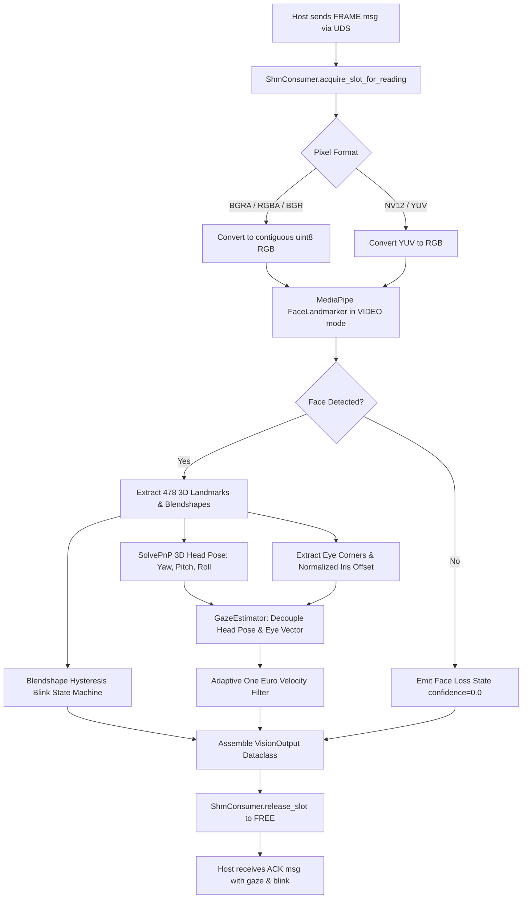

# Milestone 2: Headless Vision Engine Core Specification

## 1. Executive Summary

Milestone 2 (M2) establishes the headless computer-vision inference core for EyeMouse. Operating strictly in a decoupled, process-isolated model, the vision engine receives raw camera frames across a POSIX shared-memory ring buffer, extracts 478 MediaPipe facial and iris landmarks in `RunningMode.VIDEO`, computes normalized 2D eye features and 3D head pose, tracks blink dynamics with hysteresis, applies Casiez et al. One Euro temporal filtering, and returns structured metadata to the host via a Unix domain socket.

At no point does the vision engine open a webcam or invoke `cv2.VideoCapture`. Camera capture remains the exclusive domain of the native macOS host via AVFoundation.

---

## 2. Package Architecture and Modules

The engine is organized under `src/vision_engine/`:

```
src/vision_engine/
├── __init__.py           # Package public exports
├── types.py              # Data structures, dataclasses, enums, pixel formats
├── resources.py          # Offline asset locator (dev mode & PyInstaller _MEIPASS)
├── face_geometry.py      # Canonical 3D face mesh & Procrustes alignment basis
├── filters.py            # One Euro Filter & PointFilter2D with NaN/Inf safety
├── head_pose.py          # Perspective-n-Point 3D head rotation & Euler angles
├── eye_features.py       # Normalized iris position & eye geometry extraction
├── blink.py              # MediaPipe blendshape blink detector with hysteresis
├── gaze.py               # Replaceable GazeEstimatorProtocol & uncalibrated proxy
├── confidence.py         # Face presence & loss detection
├── landmarker.py         # MediaPipe FaceLandmarker sequential VIDEO runner
├── pipeline.py           # Core VisionPipeline coordinating inference stages
├── engine.py             # Headless VisionEngine daemon & IPC message loop
├── main.py               # CLI entry point (`--socket`, `--debug`)
└── ipc/
    ├── __init__.py
    ├── protocol.py       # Binary struct layouts, headers, slot state constants
    ├── shm_consumer.py   # Zero-copy POSIX shared-memory consumer
    └── control_server.py # Unix domain socket command/ACK server
```

---

## 3. Inference Lifecycle and Pipeline Stages



### 3.1 Timing and Execution Flow
1. **Zero-Copy Ingestion**: Raw pixel buffers mapped in POSIX shared memory are wrapped into a NumPy view without memory allocation or frame duplication.
2. **Sequential Monotonic Timestamps**: In `RunningMode.VIDEO`, MediaPipe tracks facial landmark flows temporally. Each frame supplies a monotonically increasing `timestamp_ns` (converted to milliseconds for MediaPipe).
3. **Stage Decoupling**: Head pose, eye geometry, and blink detection run as independent, modular components that communicate strictly through typed dataclasses.
4. **Immediate Slot Reclamation**: Before serialization and socket transmission, the consumer marks the shared-memory slot `SLOT_STATE_FREE` to minimize producer frame drops.

---

## 4. Key Architectural Contracts

### 4.1 Explicit Invalid State on Face Tracking Loss
When tracking fails (user turns away, occludes face, or leaves the frame):
- `output.face_detected` is set to `False`.
- `output.confidence` is `0.0`.
- `output.gaze_estimate` has `is_valid = False` and NaN-safe coordinates.
- Filter state is retained without poisoning (NaNs are rejected).
- **The system never fabricates coordinates or holds frozen coordinates as valid.**

### 4.2 Decoupling of Head Pose and Eye Movement
Eye gaze is not head pose. EyeMouse calculates:
1. **Normalized Eye Frame**: Iris center coordinates expressed relative to eye corner anchors $[(-1, -1) \dots (+1, +1)]$, invariant to face scale and head roll.
2. **Canonical Rigid Head Pose**: Solved using Levenberg-Marquardt SolvePnP on rigid facial landmarks (forehead, nose tip, chin, temples) against canonical metric face geometry.
3. **Composite Optical Proxy**: Gaze direction integrates both eye displacement and head pose compensation before passing to the replaceable estimator.

### 4.3 Replaceable Gaze Estimator Protocol
In `src/vision_engine/gaze.py`, the `GazeEstimatorProtocol` defines:
```python
class GazeEstimatorProtocol(Protocol):
    def estimate(
        self,
        eye_metrics: EyeMetrics,
        head_pose: HeadPose,
        timestamp_s: float,
    ) -> GazeEstimate: ...
```
The active implementation is `UncalibratedGazeEstimator`, explicitly documented as an optical directional proxy. Real screen-coordinate calibration is reserved for M4.

---

## 5. Frozen PyInstaller Packaging Verification

The vision engine is packaged into a standalone native ARM64 binary using `packaging/eyemouse_engine.spec`:
- **Executable**: `dist_engine/eyemouse_engine/eyemouse_engine` (Mach-O 64-bit executable arm64).
- **Bundled Assets**: Bundles `face_landmarker.task` (MediaPipe Tasks) and `geometry_pipeline_metadata_landmarks.binarypb`.
- **Zero Host Python Dependency**: Verified to boot, load native dylibs (`libmediapipe.dylib`), open IPC sockets, and execute inference in an isolated environment without source trees or active virtual environments.

