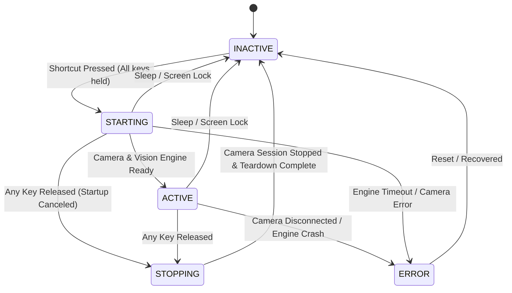

# Milestone 3: Global Keyboard Control and Safety Gate Specification

## 1. Architectural Philosophy and Non-Negotiable Safety Rules

Eye control in EyeMouse is fundamentally architected as a **physically gated modality**:
1. Eye tracking must **never** be active unless the user is physically applying continuous pressure to the configured activation shortcut.
2. The instant **any** required key or modifier in the chord is released, the safety gate closes **synchronously** in memory before any camera or engine teardown begins.
3. The event tap callback must remain microsecond-fast: it updates a thread-safe atomic flag and dispatches lightweight state changes. **Never execute video processing, camera operations, or IPC inside the event tap callback.**

---

## 2. Global Event Tap Implementation (`GlobalEventTap.swift`)

EyeMouse monitors keyboard activity across all applications (Terminal, Google Chrome, Visual Studio Code, Finder, etc.) using macOS Core Graphics event taps:

```swift
let mask = CGEventMask(
    (1 << CGEventType.keyDown.rawValue) |
    (1 << CGEventType.keyUp.rawValue) |
    (1 << CGEventType.flagsChanged.rawValue)
)

var tapPort = CGEvent.tapCreate(
    tap: .cgSessionEventTap,
    place: .headInsertEventTap,
    options: .defaultTap,         // Active modifying tap (allows key suppression)
    eventsOfInterest: mask,
    callback: eventTapCallback,
    userInfo: observer
)
```

### 2.1 Permission Distinction: Active vs Passive Tap
- **Active Modifying Tap (`.defaultTap`)**:
  - Requires **Accessibility permission** (`AXIsProcessTrusted`).
  - Allows the tap callback to return `nil` to **suppress the trigger keystrokes** so that holding the shortcut does not inject unwanted characters or control codes into foreground applications.
  - Specifically prevents `Control + M` from triggering carriage returns in Terminal, or `Control + Option + E` from inserting accent characters (`´`) or triggering application shortcuts in VS Code / Chrome.
- **Passive Listen-Only Tap (`.listenOnly`)**:
  - Requires **Input Monitoring permission** (`CGPreflightListenEventAccess`).
  - Used as a fallback if Accessibility is not yet granted. Events are observed but cannot be swallowed.

---

## 3. Keystroke Suppression and Trigger Matching

The `ShortcutConfig` defines the required chord:

```swift
public struct ShortcutConfig: Codable {
    public var requiredKeyCode: UInt16?       // e.g. KeyCodeTable.kVK_ANSI_E (14)
    public var requiredModifiersRaw: UInt64   // e.g. [.maskControl, .maskAlternate]
}
```

### 3.1 Chord Matching Logic
When an event arrives:
1. Extract event keycode and modifier flags (`event.flags`).
2. Mask flags with `[.maskControl, .maskAlternate, .maskShift, .maskCommand]` to discard device-dependent bits (e.g. numeric keypad, caps lock).
3. Verify that all required modifiers are present and no unauthorized modifiers are pressed.
4. If a target keycode is required, verify `eventKeycode == targetKeycode`.
5. If matched:
   - Mark `isTriggerHeld = true`.
   - Call `SafetyStateManager.shared.handleShortcutPressed()`.
   - Return `nil` (suppresses key from WindowServer dispatch).
6. If the target key or any modifier is released:
   - Mark `isTriggerHeld = false`.
   - Call `SafetyStateManager.shared.handleShortcutReleased()`.
   - Return `nil` for the trigger keyUp event.

---

## 4. Operating System Edge-Case Recovery

### 4.1 Event Tap Timeout and Disable Handling
Under heavy system load, macOS WindowServer may automatically disable an event tap if the callback takes too long to return. `GlobalEventTap` traps these OS notifications:

```swift
if type == .tapDisabledByTimeout || type == .tapDisabledByUserInput {
    print("[EventTap] Tap disabled by OS. Re-enabling...")
    if let port = machPort {
        CGEvent.tapEnable(tap: port, enable: true)
    }
    if isTriggerHeld {
        isTriggerHeld = false
        SafetyStateManager.shared.handleShortcutReleased()
    }
    return Unmanaged.passRetained(event)
}
```

### 4.2 Sleep, Wake, and Display Lock Recovery
If the user closes the MacBook lid or the screen locks while holding the shortcut:
- Subscribes to `NSWorkspace.willSleepNotification`, `didWakeNotification`, and `screensDidSleepNotification`.
- On sleep or screen lock: forces `isTriggerHeld = false` and calls `SafetyStateManager.shared.forceInactive(reason: "System Sleep")`.
- On wake: re-enables the event tap via `CGEvent.tapEnable(tap: machPort, enable: true)`.

---

## 5. Safety State Machine (`SafetyStateManager.swift`)

The safety state machine enforces 5 mutually exclusive operational states:



### 5.1 Synchronous Gate Verification
In `FramePipelineCoordinator.swift`, every frame received from the camera checks:
```swift
guard SafetyStateManager.shared.canProcessFrames else {
    return
}
```
Where:
```swift
public var canProcessFrames: Bool {
    os_unfair_lock_lock(&lock)
    defer { os_unfair_lock_unlock(&lock) }
    return (_state == .active || _state == .starting) && _isKeyHeld
}
```
Because `_isKeyHeld` is cleared synchronously inside `handleShortcutReleased()` on the event tap callback, subsequent camera frames that are already in flight on the serial video queue are **instantly dropped without touching shared memory or dispatching IPC notifications**.

