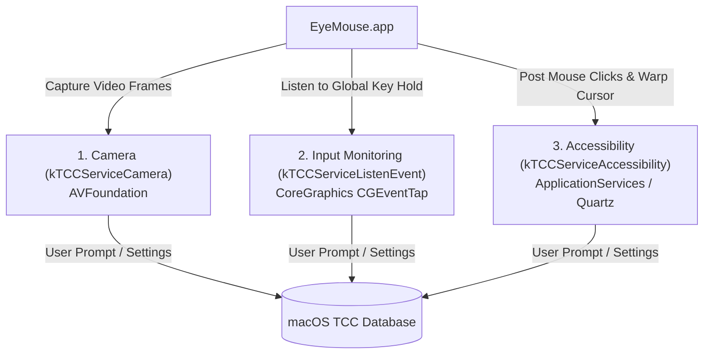

# macOS Security & Permissions Architecture (TCC)

**Audience:** macOS Application Engineers & System Administrators  
**Subsystems:** Camera, Accessibility, Input Monitoring  
**Target OS:** macOS 14.0 Sonoma through macOS 27+  

---

## 1. Overview of macOS TCC in EyeMouse

macOS enforces strict sandboxing and privacy boundaries through **TCC (Transparency, Consent, and Control)**. Because EyeMouse captures video frames for gaze estimation, listens to global keyboard events to detect physical key presses, and posts synthetic cursor events to WindowServer, it interacts with three separate TCC security domains:



Every permission is non-negotiable. If any permission is withheld, EyeMouse **fails inactive** and presents clear guidance rather than failing silently or crashing.

---

## 2. The Three Required TCC Domains

### 2.1 Camera (`kTCCServiceCamera`)
* **Purpose:** Allows the Vision Engine to capture frames from the built-in FaceTime HD camera or an external USB-C webcam.
* **API Used:** `AVCaptureDevice.authorizationStatus(for: .video)` and `AVCaptureDevice.requestAccess(for: .video)`.
* **Bundle Requirement:** The app bundle's `Contents/Info.plist` **must** include `NSCameraUsageDescription`:
  ```xml
  <key>NSCameraUsageDescription</key>
  <string>EyeMouse uses your camera locally to track eye gaze and head orientation. Video frames are processed in real-time in memory and are never recorded, saved, or uploaded.</string>
  ```
* **Failure Mode:** If denied or restricted, camera initialization returns an authorization failure. EyeMouse enters the `CAMERA_OFFLINE` state and displays a camera-disabled icon in the menu bar.

### 2.2 Input Monitoring (`kTCCServiceListenEvent`)
* **Purpose:** Required for `CGEventTapCreate` to intercept global hardware keyboard events (`kCGEventKeyDown`, `kCGEventKeyUp`, `kCGEventFlagsChanged`) when EyeMouse is not the focused foreground window.
* **API Used:** `CGRequestListenEventAccess()` and `CGPreflightListenEventAccess()`.
* **Background:** Prior to macOS Catalina, Accessibility permission was sufficient for event taps. On modern macOS (Sonoma, Sequoia, and later), global listen-only event taps specifically require **Input Monitoring** authorization.
* **Failure Mode:** If denied, `CGEventTapCreate` returns `nil`. EyeMouse cannot detect shortcut holds and remains in `MONITOR_FAILED` dormant state.

### 2.3 Accessibility (`kTCCServiceAccessibility`)
* **Purpose:** Required to inject synthetic mouse events (`CGEventPost`) to other applications and query screen coordinates across display spaces.
* **API Used:** `AXIsProcessTrustedWithOptions(options)` where options includes `kAXTrustedCheckOptionPrompt: true`.
* **Failure Mode:** If untrusted, synthetic clicks and cursor movements are silently ignored by macOS WindowServer. EyeMouse displays a warning badge indicating Accessibility must be enabled.

---

## 3. The "Stale TCC Trust" Bug & Code-Signing Strategy

### 3.1 The Problem
During development or after software updates, developers and users often encounter the notorious **TCC Stale Trust** defect:
1. In `System Settings > Privacy & Security > Accessibility`, the switch for `EyeMouse` appears **ON**.
2. Yet when `EyeMouse` runs, `AXIsProcessTrusted()` returns `false`, and `CGEventTapCreate()` fails.

### 3.2 Root Cause: Designated Requirements & cdhash
macOS identifies applications in the TCC database using their **Designated Requirement**:
- When an application is signed ad-hoc (`codesign -s -`), macOS generates a designated requirement tied directly to the binary's code directory hash (`cdhash`):
  ```text
  designated => cdhash H"3a8b...7f"
  ```
- Every time code is recompiled, the `cdhash` changes. The TCC database continues to display the application by bundle ID or file path, but the kernel rejects the new binary because its `cdhash` does not match the previously approved record.
- Users are forced to manually click "−" in System Settings to delete the stale entry and re-add the app with "+".

### 3.3 The Engineering Solution
1. **Persistent Self-Signed Certificate for Development:**
   Instead of ad-hoc signing (`-`), generate a local self-signed code signing certificate:
   ```bash
   security create-certificate -a -c "EyeMouse Development" -t codeSigning
   ```
   When signed with `"EyeMouse Development"`, the designated requirement becomes:
   ```text
   designated => identifier "com.eyemouse.app" and certificate leaf = H"..."
   ```
   Because the certificate identity remains stable across rebuilds, TCC grants survive multiple compilations!
2. **Runtime Stale-Permission Detection:**
   EyeMouse stores a fingerprint of the current executable in `~/Library/Application Support/eyemouse/last_trusted_fingerprint`. If the app was previously authorized but is now rejected, the UI explicitly alerts the user:
   > *"EyeMouse has been updated. macOS requires you to toggle EyeMouse off and on in System Settings > Privacy & Security > Accessibility."*

---

## 4. In-App User Onboarding & Permission Guidance Flow

EyeMouse provides a dedicated `PermissionsCoordinator` Swift class with direct URL schemes to open System Settings panes:

| Service | Target Settings Pane URL |
| :--- | :--- |
| **Camera** | `x-apple.systempreferences:com.apple.preference.security?Privacy_Camera` |
| **Accessibility** | `x-apple.systempreferences:com.apple.preference.security?Privacy_Accessibility` |
| **Input Monitoring** | `x-apple.systempreferences:com.apple.preference.security?Privacy_ListenEvent` |

### Onboarding Workflow
1. Upon first launch, EyeMouse detects ungranted permissions.
2. A setup window appears displaying a clear 3-step checklist:
   - [ ] Camera Access (Button: *Allow Camera*)
   - [ ] Input Monitoring (Button: *Allow Shortcut Detection*)
   - [ ] Accessibility (Button: *Allow Mouse Control*)
3. Clicking a button triggers the native OS authorization prompt or opens the exact System Settings sub-pane.
4. Live polling (`Timer.scheduledTimer`) detects when authorization is granted and updates the checklist with green checkmarks in real-time.
5. Once all three are granted, the setup window closes and EyeMouse enters its ready menu-bar state.

